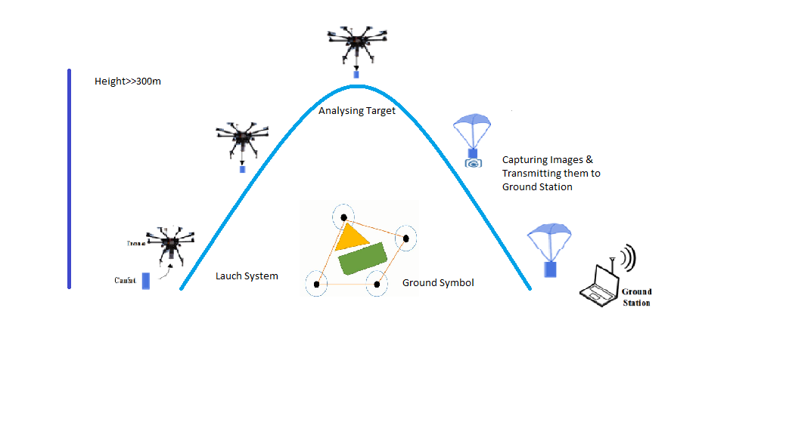

# Remote Sensing-Communication CanSat 🛰️

**🥈 2nd Place — Remote Sensing-Communication Class, 10th International Iran CanSat Competition 2024**
*Organized by the Aerospace Research Institute, Ministry of Science, Research and Technology*

A fully self-designed and built CanSat (a "satellite" packed inside a soda-can-sized envelope) that measures atmospheric data, captures images during descent, performs onboard target detection, and transmits everything to a custom ground station in real time — built from scratch by a team of first-time competitors.



---

## 📋 Mission Overview

The CanSat is deployed from a drone at ~300 m altitude, descends under a custom parachute, and during descent must:

- Measure **temperature, air pressure, altitude**, and (bonus) humidity/orientation
- Capture **at least 3 images** of ground targets during descent
- Detect the **enclosed area and color** of ground targets via image processing
- Transmit **all telemetry in real time** to a self-built ground station over LoRa
- Achieve a **safe landing** (descent rate ≤ 5 m/s) as close as possible to the target area
- Declare its position after landing via an onboard beacon

Full mission requirements are defined by the competition organizers — see [`docs/Competition_Guidelines.pdf`](docs/Competition_Guidelines.pdf).

## 🏆 Result

The team — competing under the name **SITTians**, representing the **SUPARCO Institute of Technical Training (SITT)** — placed **2nd internationally** in the Remote Sensing-Communication class, in their first-ever CanSat competition.

## 👥 Team & My Role

| Member | Responsibility |
|---|---|
| Junaid Sultan Ali | (Supervisor/Team Lead) |
| **Qaisar Khan** | **Electronics soldering and testing, Sensor subsystems, EPS, flight software & GCS** |
| Hamza Ahmed |EPS Programming/ flight software & GCS  , Sensor subsystem & EPS |
| Muhammad Usman, Dilawar Khan |Mechanical/structure support|
| Abdul Jabbar | communication, pcb designing |

My primary contributions were the **sensor subsystem** (BMP-280, MPU-6050 integration) and the **electrical power system** design (battery management, voltage regulation, power distribution) — see [`hardware/pcb/CANSAT_EPS`](hardware/pcb/CANSAT_EPS) and [`hardware/pcb/CANSAT_SENSOR`](hardware/pcb/CANSAT_SENSOR).

## 🛠️ System Architecture

The CanSat is built around a stacked 4-PCB design (Power / Communication / Sensor / Payload) inside a 3D-printed, hollow hexagon-perforated shell that keeps antennas and GPS unobstructed while staying under the 350 g / 66×115 mm competition limits.

| Subsystem | Key Components |
|---|---|
| **Compute** | ESP32-WROOM (main flight controller) + ESP32-C3 SuperMini |
| **Sensors** | BMP-280 (pressure/altitude), MPU-6050 (orientation/IMU), NEO-6M (GPS) |
| **Camera/Payload** | ESP32-CAM (1080×640 @ up to 60 fps, onboard SD storage) |
| **Communication** | LoRa SX-1278 (433 MHz, up to 10 km rural range, <100 mW Tx) |
| **Recovery** | Custom flat/hexagonal parachute, sized for ≤5 m/s descent (achieved ~4.5 m/s) |
| **Power** | 2S Li-ion battery + BMS, regulated 3.3 V / 5 V rails |
| **Beacon** | Buzzer for post-landing location |

Subsystem block diagrams: [`hardware/subsystem-schematics`](hardware/subsystem-schematics)
PCB schematics & layouts (Altium): [`hardware/pcb`](hardware/pcb)

## 💻 Firmware

| Folder | Runs on | Purpose |
|---|---|---|
| [`firmware/ESP32_SUPERMINI`](firmware/ESP32_SUPERMINI) | ESP32-C3 SuperMini | Sensor polling, RTC, CSV telemetry framing, LoRa TX, triggers image capture |
| [`firmware/ESP32_CAM`](firmware/ESP32_CAM) | ESP32-CAM | RTOS-based image capture (5 frames/descent) to onboard SD, serial data logging |
| [`firmware/GCS`](firmware/GCS) | Ground station ESP32 | LoRa receiver, serial telemetry passthrough |

Telemetry format (alpha-recovery order, per competition spec):
```
packet, RTC_time, gps_lat, gps_lon, gps_speed, temp, pressure, altitude, roll, pitch, accel_x/y/z, gyro_x/y/z
```

> ⚠️ **Note before making this repo public:** `ESP32_SUPERMINI.ino` and `ESP32_CAM.ino` currently have a Wi-Fi SSID/password hardcoded for the CAM's local access point. It's a low-risk local AP (not a real network), but if you'd like, I can move it into a `secrets.h` (gitignored) before you push — just say the word.

## 🧮 Recovery System — Parachute Sizing

The hexagonal flat parachute was sized using the drag-equation balance (F_gravity = F_drag), targeting a 5 m/s descent rate at 350 g mass:

D = √(8mg / (π·C_d·ρ·v²)) ≈ 591 mm → hexagon side length ≈ 324 mm

Full derivation: [`docs/Final_Project_Report.pdf`](docs/Final_Project_Report.pdf) (Section 6-2).

## 📁 Repo Structure

```
├── firmware/              # Arduino/C++ source for CanSat + Ground Station
│   ├── ESP32_CAM/
│   ├── ESP32_SUPERMINI/
│   └── GCS/
├── hardware/
│   ├── pcb/                    # Altium schematic + PCB layout files
│   └── subsystem-schematics/   # Block diagrams (power, comm, sensor, structure, recovery, GCS)
├── docs/                  # PDR, CDR, Final Project Report, competition guidelines
└── media/                 # Mission profile diagram (+ video linked below)
```

## 🎥 Flight Test Video & Photos

📹 [Watch the flight test video and view build photos](https://drive.google.com/drive/u/0/folders/1vkQAq4ylp5WScTySMpFzcRtd9SzQPtEW) *(hosted on Google Drive due to file size)*

## 📄 Documentation

- [Preliminary Design Review (PDR)](docs/PDR.docx)
- [Critical Design Review (CDR)](docs/CDR.docx)
- [Final Project Report](docs/Final_Project_Report.pdf) — full design rationale, test results, and complete firmware listing
- [Competition Guidelines](docs/Competition_Guidelines.pdf)

## 🙏 Acknowledgments

Built at the SUPARCO Institute of Technical Training (SITT) under the guidance of Director SITT (Ahson Ansari), DH Electronics (Sohail Ahmed), Danish-ul-Khairi, Umair Siddique, and supervisor Junaid Sultan, with image processing support from Sir Haseeb's group and fabrication support from the Mechanical Department and SETC PCB Lab.

---
*This project was developed as part of the Diploma Associate Engineering (Electronics) program, submitted October 2024.*
